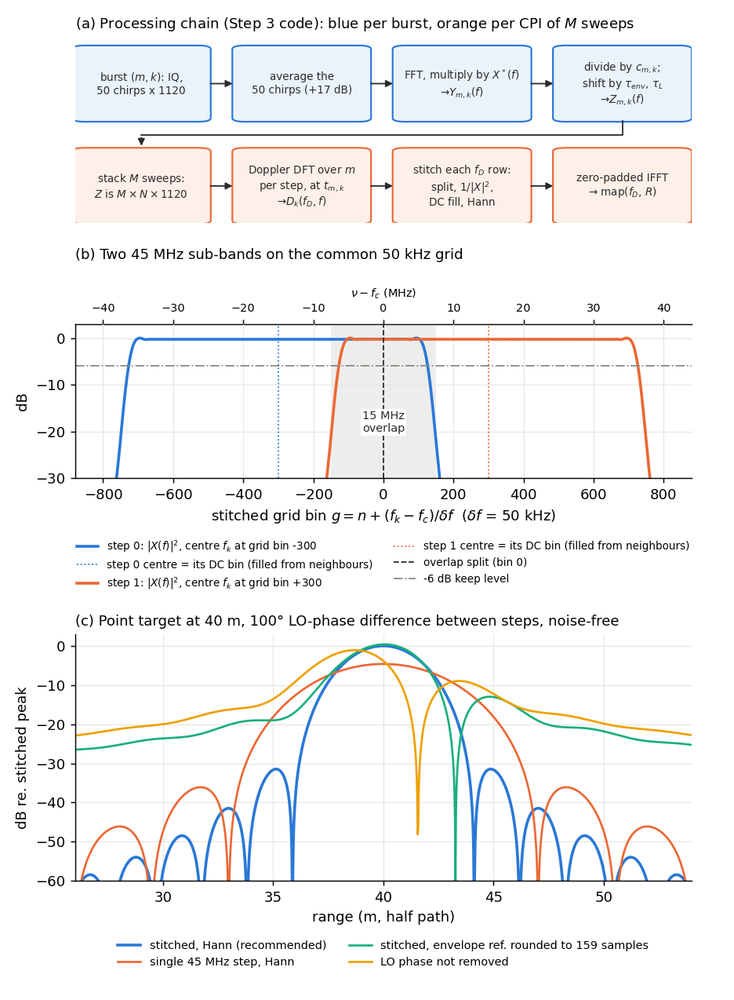
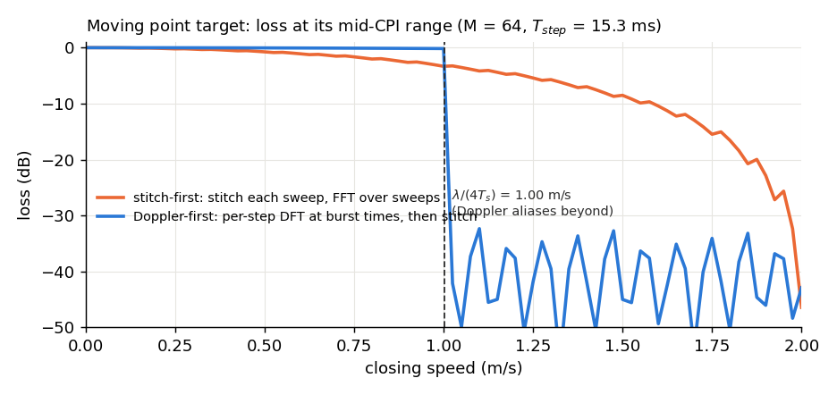

# Delay-Doppler from stitched stepped chirps: method

Method for `b210_sar.processing.delay_doppler` (directive b210-13, Step 1), revised 2026-11-06 to
match the Step 3 code (`processing/{pulse,calibration,delay_doppler}.py`, `sim.py`).
Parameters come from `configs/default.yaml`, `capture/src/*.cpp` and the RX-only run
`run_20261106_155516_rx` (1959 bursts, default config). Simulated numbers and figures come from
`docs/figures/delay_doppler_figures.py`, a noise-free numpy model. Implementation details are left to those modules.

## 1. Parameters (verified)

| Quantity | Value | Source |
|---|---|---|
| $N$ steps, step spacing $\Delta f$ (capital), chirp band $B$ | 2, 30 MHz, 45 MHz; step centres $f_k$ = 2426.75, 2456.75 MHz; band centre $f_c$ = 2441.75 MHz | config, bursts.csv |
| $f_s$, $T_c$, $N_c$ | 56 MS/s, 20 µs, 1120 samples; up-chirp $-B/2\to+B/2$, 5 % taper | `chirp.cpp` |
| Burst | 50 chirps (56000 samples); TX sends 51 and starts one chirp early, so the RX window sees a periodic signal (§2) | `make_tx_burst` |
| $T_{step}$ / sweep $T_s$ (mean $\bar T_s$) | 15.32 / **30.64 ms** mean (σ 0.34, max 32.82 ms); budget 18.2 / 36.40 ms | bursts.csv, `run_log.txt` |
| $\lambda$; baseband latency $\tau_{sys}$ | 12.28 cm; ≈ 159 samples (2.84 µs), the leakage peak on the cabled bench | config, `design_notes.md` |

## 2. Signal model

Burst $(m,k)$ is sweep $m$ (of $M$ per CPI, the coherent processing interval), step $k$, starting at USRP time $t_{m,k}$. Its 50 chirps are averaged
(17 dB gain), transformed on the bin grid $f=n\,\delta f$ ($n=-560\dots559$; $\delta f=f_s/N_c$ = 50 kHz, not the 30 MHz step
spacing $\Delta f$) and multiplied by $X^*(f)$ (matched filter), where $X(f)$ is the DFT of the transmitted replica (`chirp_replica.cf32`,
`chirp.generate_chirp`):

$$Y_{m,k}(f) = |X(f)|^2\, e^{j\phi_{m,k}}\, e^{-j2\pi f\tau_{sys}} \sum_i a_i\, e^{-j2\pi \nu\,\tau_i(t_{m,k})},\qquad \nu=f_k+f .$$

- Path $i$ has complex amplitude $a_i$ and delay $\tau_i$ = bistatic path / $c$, so $R=c\tau/2$. A
  closing speed $v$ gives $\tau_i(t)=\tau_{i0}-2vt/c$ and $f_D=2v/\lambda$. $\nu$ is the absolute RF
  frequency of bin $n$.
- The leakage is the path with $a_L$, $\tau_L$ = antenna separation / $c$: 1–10 ns (0.06–0.56
  samples) for 0.3–3 m. Its peak sits at $\tau_{env}=\tau_{sys}+\tau_L$, so $\tau_{env}\approx\tau_{sys}$.
- $\tau_{sys}$ shifts the envelope only; it is not fitted separately but absorbed into $\tau_{env}$ (§3). $\phi_{m,k}$ is the TX-RX synthesizer phase, random
  after every retune (consecutive bursts spread by about 100°).
- $y_{m,k}(\tau)=\frac1{N_c}\sum_{f\ne0}Y_{m,k}(f)\,e^{+j2\pi f\tau}$ is the compressed pulse at any,
  also fractional, delay $\tau$.

LFM range-Doppler coupling (7 ps) and Doppler within a dwell (< 0.01 dB) are negligible. Circular
compression is exact for $\tau+\tau_{sys}\le T_c$, because the TX lead keeps the RX window in
steady state. Order of operations throughout: average → matched filter → LO/delay correction (§3) →
Doppler per step (§6) → stitch per Doppler row (§4) → window → IFFT.

## 3. Removing the per-step LO phase

$\phi_{m,k}$ changes on every retune, so no stored calibration predicts it; every burst is
referenced to its own leakage (a later hardware option: a cabled TX reference on RX channel B):

$$Z_{m,k}(f) = \frac{Y_{m,k}(f)}{c_{m,k}}\, e^{+j2\pi f\tau_{env}}\, e^{-j2\pi(f_k-f_c+f)\tau_L},
\qquad c_{m,k}=\frac{y_{m,k}(\tau_{env})}{E_X},\ \ E_X=\tfrac1{N_c}\textstyle\sum_{f\ne0}|X|^2 .$$

$E_X$ normalises $c$ to the matched-filter gain of a unit path; the $f=0$ bin is left out of both sums because it holds a
DC offset, not target signal (§4).

$c_{m,k}$ is $y$ evaluated at the fractional $\tau_{env}$ by the direct sum above (exact
interpolation). It equals $a_Le^{j\phi_{m,k}}e^{-j2\pi f_k\tau_L}$, so $Z\propto(a_i/a_L)|X|^2e^{-j2\pi\nu\tau_i}$ up to one constant: consistent across steps.

- **$\tau_{env}$ is fitted once per run** (`fit_leakage_cal`) on bursts of a static scene: maximise
  $\sum_m|y_m(\tau)|^2$, on an 8× zero-padded grid, then golden-section to $10^{-6}$ sample. Only
  magnitudes enter, so $\phi$ needs no prior removal; the leakage must be the strongest return in
  the search window.
- **It must be fractional.** An error $\delta$ puts a phase jump $2\pi\Delta f\delta$ at the
  junction; rounding to 160 samples raises the peak sidelobe level (PSL, highest sidelobe relative to the mainlobe) by 12.6 dB (Appendix A.1, test B6).
- **Sign of the $\tau_L$ term (resolved in Step 3).** Dividing by $c$ leaves
  $e^{-j2\pi\nu(\tau_i-\tau_L)}$, range measured from the leakage; $e^{-j2\pi(f_k-f_c+f)\tau_L}$
  restores $\tau_i$. The earlier plan's $e^{+j2\pi f_k\tau_{leak}}$ is wrong under this
  model. Test B4 (3 m leakage, target at 37.3 m): this sign gives 37.300 m, the earlier plan's 34.300 m,
  no term 35.801 m. Sim and code share the model; a corner reflector at a surveyed range confirms it
  on hardware (b210-17).

The stored calibration holds only static terms: $\tau_{env}$ and $\tau_L$ (from the antenna separation, or
fitted on a corner reflector). A phase-only option divides by $c/|c|$ instead, removing $\phi$ but
keeping amplitudes in counts rather than $a_i/a_L$. RX-only runs (TX off) have no leakage and so no
reference: the correction is skipped ($Z=Y$), the steps do not add coherently, and such runs serve only for
noise floor and timing.

## 4. Stitching

*Fig. 1. (a) The implemented chain. (b) Each step's $|X|^2$ on the stitched grid (top: RF offset). (c) Point target at 40 m, 100° LO-phase difference between the steps; the 0.3 m leakage
serves as the reference and is not plotted.*

Use **frequency-domain concatenation** [`wilkinson1998`; `lord1997`; `nel2002`]. Time-domain
synthesis reconstructs the same band but must upsample and frequency-shift every pulse, which Lord
[`lord2000`] found inefficient. Step $k$'s bin $n$ goes to grid bin $g=n+(f_k-f_c)/\delta f$, i.e.
$n-300$ for step 0 and $n+300$ for step 1 (Fig. 1b); `Processor` raises `ValueError` unless
$\Delta f/\delta f$ is an integer (here 600). Per step:

1. Keep bins with $|X|^2$ above −6 dB of its peak (drops the taper skirts).
2. Split the 15 MHz overlap at its midpoint, so each $g$ comes from one step. Summing the overlap
   causes ripple [`yuan2009`]: 3.48 m, −26.0 dB here.
3. Equalize by $1/|X|^2$.
4. **DC bin** (step centre): its own value is never used, since a DC offset with random phase per
   burst would smear across Doppler. By default (`dc="interpolate"`) it is replaced by the mean of
   its two equalized neighbours.
   Zeroing it (the original plan, `dc="zero"`) leaves a missing spectral line (Appendix A.3).

Then one window (Hann default; Hamming or rect) spans the whole stitched support, the lowest to the
highest kept $g$ (≈ 75 MHz), and the IFFT is zero-padded ≥ 4×.

## 5. Resolution, sidelobes, ambiguities (formulas for b210-11)

| Quantity | Formula | Default |
|---|---|---|
| Band; nominal resolution | $B_{tot}=(N-1)\Delta f+B$; $\Delta R=c/(2B_{tot})$; one step $c/(2B)$ | 75 MHz; 2.00 m; 3.33 m |
| Measured −3 dB width / PSL (figure script; Fig. 1c) | stitched: Hann 3.00 m / −31.5 dB, rect 1.85 m / −13.3 dB; one step, Hann 5.08 m | [`harris1978`] |
| Range ambiguity | $c/(2\delta f)=cT_c/2$; steady state $R<c(T_c-\tau_{sys})/2$ | 2998 m; ≈ 2.57 km |
| Doppler axis, resolution | $f_D=j/(M\bar T_s)$, $j=-M/2\dots M/2-1$ ($M$ sweeps per CPI, $\bar T_s$ mean sweep period); $1/(M\bar T_s)$ | 0.51 Hz at $M$=64 |
| Velocity span, resolution | $v_{amb}=\pm\lambda/(4\bar T_s)$; $\lambda/(2M\bar T_s)$ | ±1.00 m/s; 3.1 cm/s |

$\Delta R$ is the window-free figure; the Hann mainlobe is 1.5× wider. A target at closing speed
$v$ ($v>0$ closing, giving positive $f_D$, as implemented) lands in Doppler bin $j=\mathrm{round}(2vM\bar T_s/\lambda)$, wrapped into $-M/2\dots M/2-1$
when $|v|>v_{amb}$. There are no grating lobes at $c/(2\Delta f)$ = 5 m, because the sub-bands are
contiguous. **For b210-11:**
`compute_budget` uses `retune_s` = 9.2 ms and reports 36.40 ms (±0.84 m/s, 2.6 cm/s).

## 6. Target motion

*Fig. 2. Loss at the mid-CPI range. Each burst has its own range, timestamp (σ 0.34 ms) and LO
phase. M = 64, Hann in range and Doppler.*

Stitching each sweep first and transforming over sweeps at the sweep time leaves step $k$, recorded
$kT_{step}$ later, with an extra $2\pi f_DkT_{step}$. The loss is about $\cos(\pi f_DT_{step})$:
−0.7 dB at 0.5 m/s, −3.3 dB at 1 m/s. **The code transforms Doppler first** (Fig. 1a): after averaging, matched filtering and the §3 correction, $Z$ is
stacked as $M$ sweeps × $N$ steps × $N_c$ bins and each step is transformed at its own burst times,

$$D_k(f_D,f)=\frac{\sum_m w_m\,Z_{m,k}(f)\,e^{-j2\pi f_D (t_{m,k}-\bar t)}}{\sum_m w_m},$$

with $w_m$ the slow-time window (Hann default, 0 for a missing burst) and $\bar t$ the mean time of
the CPI's valid bursts. Since $Z_{m,k}\propto e^{-j2\pi\nu\tau_i(\bar t)}e^{+j2\pi\nu(2v/c)(t_{m,k}-\bar t)}$,
the matching $f_D$ cancels the second factor in every step.
Each $D_k$ then carries the phase of a static target at $\tau_i(\bar t)$, and each $f_D$ row is
stitched as in §4 (then windowed and inverse-transformed) with no further correction. The per-burst $t_{m,k}$ is the step compensation: it
removes $2\pi f_DkT_{step}$ exactly. Loss stays under 0.2 dB up to $v_{amb}$.

What is ignored:

- **Aliasing.** When $|v|>v_{amb}$ the target appears at $f_D-p/\bar T_s$, and the step
  compensation is off by $2\pi p\,kT_{step}/\bar T_s$ (π for $N=2$, $p=1$), which splits the lobe.
- **Range walk over the CPI** [`perry1999`], and the $\nu/f_c$ Doppler scaling. Both are
  negligible while $M\le\Delta R/(2|v|\bar T_s)$: 32 at 1 m/s, 65 at 0.5 m/s.
- **Zero Doppler.** Leakage and static clutter sit at $f_D=0$. `remove_static=True`
  (`remove_static_clutter`) subtracts each step's mean $Z$ over the CPI before the Doppler DFT; off by default.

Other configurations ($N\neq2$): Appendix A.2. Tests: Appendix B.

## Confidence

Derivation and formulas, checked by the model: **high**. Not yet tested on hardware:

- whether the antenna leakage is stable enough to serve as $c_{m,k}$;
- whether $\tau_{env}$ can be fit to ~1 ns on real data (shown in simulation only, test 3; hardware pending b210-17);
- antenna phase-centre drift with frequency.

The literature supports the method choices only: **medium-high**. Lord and Yuan are cited from
their abstracts, and Wehner and Levanon at chapter level.

## Appendix A

### A.1 Envelope-error PSL (from §3)

Simulated PSL (figure script, no leakage lobe) is −29 dB at 0.02 samples, −25.7 dB at 0.05, and
−13.4 dB at 0.36 samples (0.3 m leakage, $\tau_{env}$ = 159.36 rounded to 159).

### A.2 Other configs

For any $N$: $f_k=f_c+(k-\tfrac{N-1}{2})\Delta f$, and the split points fall midway between
adjacent step centres.

- **Raise an error** if $\Delta f/\delta f$ is not an integer.
- **Warn** if $\Delta f>0.9B$ (40.5 MHz here): the spectral gaps give grating lobes at multiples of $c/(2\Delta f)$
  [`levanon2004`; `wehner1995`].
- $\bar T_s\approx NT_{step}$, so $v_{amb}\propto1/N$.
- The envelope tolerance is $\delta\lesssim10°/(360°\,\Delta f)$.

### A.3 DC bin

With Hann, zeroing the DC bin gives a −54.6 dB floor under the leakage and holds a target 20 dB below the
leakage to PSL −29.1 dB; interpolating gives −75.7 dB and −31.5 dB.

## Appendix B: test list (Step 3, `tests/test_delay_doppler.py`)

Noise-free unless stated. The sim uses random $\phi_{m,k}$, $\tau_{sys}$ = 159.3 samples and a 3 m
leakage path ($\tau_L$ = 10.0 ns, $\tau_{env}$ = 159.86 samples, fitted).

1. `generate_chirp` against `chirp_replica.cf32`: maximum error ≤ 3e-5.
2. `average_chirps`: 50 periods return the pulse; with noise, SNR gain is 17 ± 0.5 dB.
3. `range_compress`: a delay of $d$ samples peaks at $d\times$upsample; $\tau_{env}$ fit < 0.01 samples.
4. Stationary target at 37.3 m: peak within 0.2 m, zero-Doppler bin. Opposite $\tau_L$ sign: 34.3 m.
5. Random against coherent LO phase: peak loss < 0.1 dB noise-free, < 1 dB at 20 dB SNR; target
   20 dB below the leakage, PSL ≤ −30 dB.
6. Negative control: $\tau_{env}$ rounded to an integer raises PSL by > 10 dB.
7. −3 dB width (Hann): 3.00 m ± 5 % stitched, 5.08 m ± 5 % for one step.
8. Two equal targets 3.0 m apart (rect) or 5.0 m apart (Hann): the stitched profile dips ≥ 1.5 dB
   at all 13 relative phases, and one step fails at some phase. Targets exactly $c/(2B_{tot})$
   apart are not reliably resolved under any window.
9. Target at 0.5 m/s, $M$ = 64: Doppler bin within ½ bin of $2vM\bar T_s/\lambda$; loss < 0.5 dB.
10. Test 9 repeated with the real `usrp_time_s` of `run_20261106_155516_rx`.
11. Leakage sits at $c\tau_L/2$ = 1.5 m in the zero-Doppler bin. A 3000-count DC offset with random
    per-burst phase stays ≤ noise + 1 dB off zero Doppler.
12. $\Delta f$ = 30.01 MHz (non-integer $\Delta f/\delta f$) raises `ValueError`. $N$ = 3 at
    $\Delta f$ = 15 MHz (again $B_{tot}$ = 75 MHz; heavy overlap, far below the $0.9B$ gap warning of
    A.2) passes tests 4 and 7.

## Sources

- `wehner1995` — Wehner, D. R. (1995), "High-Resolution Radar," 2nd ed., *Artech House*, ISBN 978-0-89006-727-7. url:https://us.artechhouse.com/High-Resolution-Radar-Second-Edition-P469.aspx
- `wilkinson1998` — Wilkinson, A. J., Lord, R. T., Inggs, M. R. (1998), "Stepped-frequency processing by reconstruction of target reflectivity spectrum," *Proc. COMSIG 1998*, pp. 101-104. doi:10.1109/COMSIG.1998.736930
- `lord1997` — Lord, R. T., Inggs, M. R. (1997), "High resolution SAR processing using stepped-frequencies," *IGARSS'97*, pp. 490-492. doi:10.1109/IGARSS.1997.615924
- `lord2000` — Lord, R. T. (2000), "Aspects of stepped-frequency processing for low-frequency SAR systems," *PhD thesis, University of Cape Town*. url:http://hdl.handle.net/11427/40264
- `nel2002` — Nel, W., Tait, J., Lord, R., Wilkinson, A. (2002), "The use of a frequency domain stepped frequency technique to obtain high range resolution on the CSIR X-band SAR system," *IEEE AFRICON 2002*, pp. 327-332. doi:10.1109/AFRCON.2002.1146857
- `yuan2009` — Yuan, H., Gao, M., Liu, G. (2009), "Coherent spectrum synthesis of frequency-stepped chirp signal," *IET Int. Radar Conf. 2009*. doi:10.1049/cp.2009.0271
- `levanon2004` — Levanon, N., Mozeson, E. (2004), "Radar Signals," *Wiley*. doi:10.1002/0471663085
- `harris1978` — Harris, F. J. (1978), "On the use of windows for harmonic analysis with the discrete Fourier transform," *Proc. IEEE* 66(1), pp. 51-83. doi:10.1109/PROC.1978.10837
- `perry1999` — Perry, R. P., DiPietro, R. C., Fante, R. L. (1999), "SAR imaging of moving targets," *IEEE Trans. AES* 35(1), pp. 188-200. doi:10.1109/7.745691
