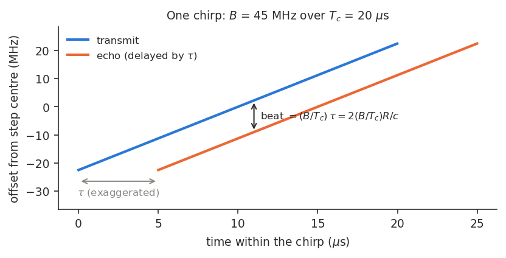
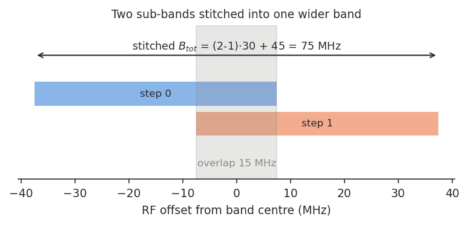
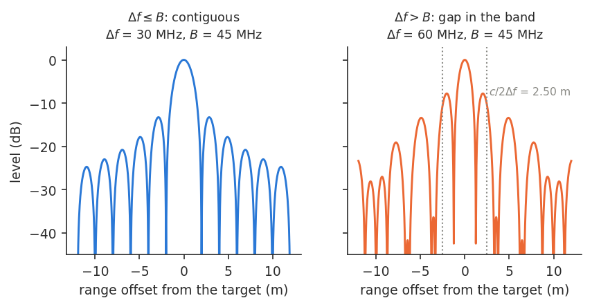
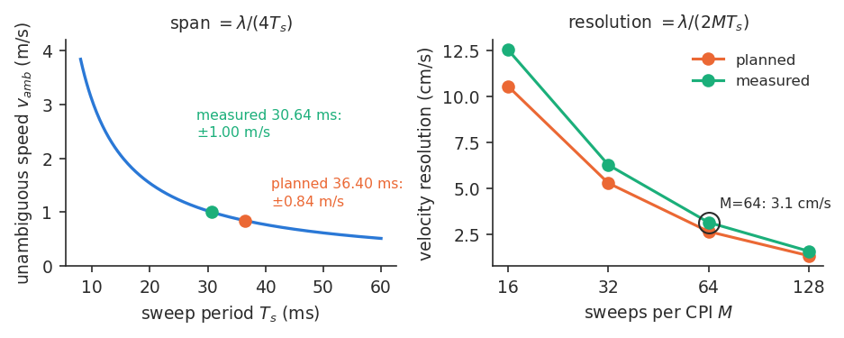
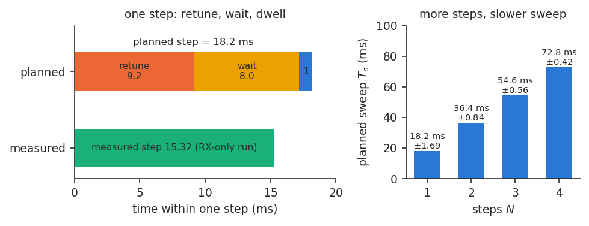

# Stepped-frequency radar: a primer for sar_b210

All numbers are for `configs/default.yaml`. Formulas are those of
[`docs/delay_doppler.md`](../delay_doppler.md) (the method doc) §5; derivations are in its §2-§4 and are not repeated here.
Terms: $c$ = 299 792 458 m/s (with 3e8, $R_{amb}$ below would read 3000 m); the *carrier* is the centre of the stitched band, the midpoint of the step centres (2426.75 and 2456.75 MHz), $f_c$ = 2441.75 MHz = `center_freq_hz`, and
$\lambda=c/f_c$ = 12.28 cm is its wavelength (for a new config, use its `center_freq_hz`, the midpoint, not step 0).

## 1. One chirp: delay becomes frequency

The radar transmits a linear sweep (a chirp) of bandwidth $B$ over a time $T_c$. An echo from a target is the
same sweep, late by the round-trip delay $\tau$. At any instant the echo's frequency therefore differs from the transmitted one in proportion to $\tau$ (Fig. 1). Mixing the echo with the
transmit signal turns it into a tone; matched filtering it (correlating the echo against a copy of the transmitted
chirp) gives a peak. sar_b210 does the matched filter (method doc §2); the beat tone is the same
information. Range is $R=c\tau/2$.

*Fig. 1. TX chirp and a delayed echo. The vertical gap between them is the beat frequency.*

$T_c$ is the config's `chirp_length_s`, and must be a whole number of samples: $N_c=T_cf_s$ (here 20 µs × 56 MS/s = 1120).
Default: $B$ = 45 MHz, $T_c$ = 20 µs: 15 kHz of beat per metre; one chirp alone resolves 3.33 m.

## 2. Stepping and stitching: more band than one chirp can carry

Range resolution comes from bandwidth, and one chirp is limited to what the radio passes: complex (I/Q) baseband at
$f_s$ = 56 MS/s covers about 56 MHz, of which the default uses 45 MHz so the filter edges stay clear (guidance: keep $B\lesssim0.8f_s$; the validated limit is $B\le f_s$). So the radar retunes its centre frequency by $\Delta f$,
sends the next chirp, and glues the sub-bands side by side in the frequency domain (Fig. 2). The occupied
band is $B_{tot}=(N-1)\Delta f+B$. The synthesizer phase is random after every retune. The leakage (the direct TX-to-RX path, a strong echo at a known
delay in every step) is a reference: dividing each step by its own leakage phase removes that random phase, so the pieces add coherently
(method doc §3, stitching §4). The sub-bands overlap
on purpose, so the band stays continuous after the edges are discarded: the 5 % taper at each end of the chirp and any bins more than 6 dB below the peak (method doc §4). A small overlap must cover those.

*Fig. 2. Two 45 MHz sub-bands 30 MHz apart, overlapping by 15 MHz, make one 75 MHz band.*

Default: $N$ = 2, $\Delta f$ = 30 MHz, $B_{tot}$ = 75 MHz.

## 3. Range resolution, maximum range, and the gap rule

Resolution is set by the stitched band alone: $\Delta R=c/(2B_{tot})$. The farthest unambiguous echo is set by
the chirp length: $R_{amb}=cT_c/2$, because an echo later than $T_c$ wraps into the next chirp. It is an ambiguity
limit, not a detection range.

The sub-bands must touch or overlap, $\Delta f\le B$. If they do not, the stitched spectrum has a hole, and the
range profile grows extra lobes (grating lobes) near $c/(2\Delta f)$ that can pass for targets (Fig. 3). The code
warns above $\Delta f>0.9B$ (40.5 MHz here), since the discarded edges eat into the overlap (method doc A.2).

*Fig. 3. Range profile of a point target, flat spectrum, no window (illustrative). Left: the default, first sidelobe −13.5 dB.
Right: $\Delta f$ = 60 MHz, above the 40.5 MHz warning: a shoulder at −7.8 dB near ±2 m ($c/(2\Delta f)$ = 2.50 m for an ideal gap).*

Default: $\Delta R$ = 2.00 m, $R_{amb}$ = 2998 m, $\Delta f/B$ = 0.67 (no gaps).

## 4. Doppler across sweeps: speed from slow time

Within a chirp, range is a frequency: this is **fast time**. A moving target also changes its delay a little from sweep
to sweep, which rotates the echo's phase. A **sweep** is one pass through all $N$ steps, taking $T_s$ (assumed uniform). Follow one range bin's phase over $M$ consecutive sweeps. The sweep-to-sweep index is
**slow time**, sampled once per $T_s$, and the $M$ sweeps form one coherent processing interval (CPI). The phase rotation
across them is a Doppler frequency.
A target closing at speed $v$ gives $f_D=2v/\lambda$. Sweeps sample it once per $T_s$, so $f_D$ is unambiguous only within
$\pm 1/(2T_s)$, i.e. the **unambiguous velocity** is $\pm v_{amb}=\pm\lambda/(4T_s)$, a full span of $2v_{amb}$ (faster targets alias), and over $M$ sweeps $f_D$ resolves to
$1/(MT_s)$, i.e. a velocity resolution $\lambda/(2MT_s)$. (Fig. 4).

*Fig. 4. Left: $v_{amb}$ against $T_s$. Right: velocity resolution against $M$, both $T_s$ shown (values at $M$ = 64 annotated).*

Default, $M$ = 64: planned $T_s$ 36.40 ms gives ±0.84 m/s, 2.6 cm/s; measured 30.637 ms (RX-only run) gives
±1.00 m/s, 3.1 cm/s. Plan a TX+RX run with ±0.84 m/s.

## 5. The time budget: where $T_s$ comes from

Each step costs three things, in order: **retune** (`retune_s`: the synthesizer, the local oscillator that sets the carrier, is commanded to the new frequency and
locks; 9.2 ms here, measured on the B210), **wait** (`settle_margin_s`: after locking, the oscillator's phase and leakage keep drifting for
a while, so the burst (one dwell of chirps at one step, one row of `bursts.csv`) is held back until it is stable; 8.0 ms, or `command_lead_s` (2.0 ms) + $T_c$ = 2.02 ms if that is longer, since the host
issues the timed TX/RX commands that far ahead of the burst) and **dwell** (`dwell_s` = 1.0 ms: 50 chirps of 20 µs, whose average
gains 10 log10 50 = 17 dB of signal-to-noise ratio, as noise is independent between chirps).
$T_s$ is therefore **derived, not an input**: $T_s\approx N\times$(retune + wait + dwell), here 2 × 18.2 ms. A config that asks for a
faster sweep than this arithmetic allows is inconsistent.

More steps or a longer dwell buy band or energy at the price of a smaller $v_{amb}$.

*Fig. 5. Left: one step, planned (from the config) and measured (RX-only run). Right: planned sweep time against $N$, with $v_{amb}$.*

## 6. Worked example: `configs/default.yaml`

| Quantity | Value |
|---|---|
| $N$, $\Delta f$, $B$ | 2, 30 MHz, 45 MHz |
| $f_s$, $T_c$, dwell | 56 MS/s, 20 µs, 1 ms (50 chirps) |
| $B_{tot}$; $\Delta R$ | 75 MHz; 2.00 m |
| $R_{amb}$ | 2998 m |
| $T_s$ planned / measured | 36.40 ms / 30.637 ms |
| $v_{amb}$ planned / measured | ±0.84 m/s / ±1.00 m/s |
| Velocity resolution at $M$ = 64 | 2.6 cm/s / 3.1 cm/s |

**Why the measured sweep is shorter than planned.** Planned $T_s$ is 2 × 18.2 ms (§5). Measured
is the mean step-0 to step-0 gap in the run's `bursts.csv` (`run_20261106_155516_rx`, 980 sweeps, σ 0.34 ms): 15.32 ms per step, so
the retune would be 6.32 ms, not 9.2. A TX+RX bench run in `docs/design_notes.md` had an 18.3 ms burst spacing, matching the plan.
No repo doc explains the gap. HYPOTHESIS: RX-only runs retune only RX, so are faster. Test: back-to-back TX+RX and RX-only runs, comparing step periods.
