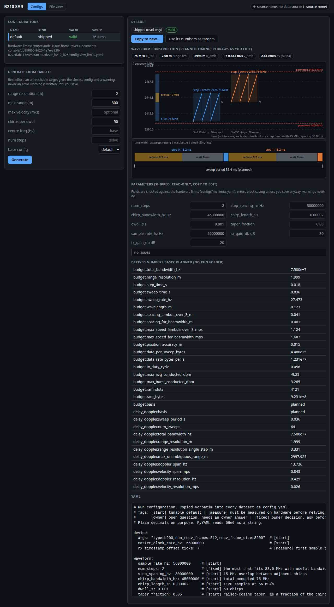

# 1 - Configs: the library, the limits and the GUI

A run config is one YAML file that fixes the waveform, gains, band and timing; it is copied into every run folder. Needs [tutorial 0](00_install.md). Nothing here opens the radio or transmits.

## Shipped and user configs

`configs/default.yaml` is shipped and read-only: never edit it, copy it. Your configs live in `configs/user/<name>.yaml` (gitignored). Saving validates first and never overwrites. Checks come from `configs/hw_limits.yaml` plus internal consistency (for example the master clock must be a whole multiple of the sample rate).

## The CLI

```bash
env -u PYTHONPATH uv run python -m b210_sar.configs --list                # shipped and user configs, valid or not
env -u PYTHONPATH uv run python -m b210_sar.configs --show default        # print the YAML
env -u PYTHONPATH uv run python -m b210_sar.configs --check default       # validate; print the parameter budget
env -u PYTHONPATH uv run python -m b210_sar.configs --check default --sweeps 32   # delay-Doppler numbers for M=32
env -u PYTHONPATH uv run python -m b210_sar.configs --list --json         # machine-readable (also for --check)
```

`--check` takes a name or a path. Exit status: 0 valid, 1 invalid, 2 unknown config. The budget lists the band, range resolution, sweep time, data rate, TX duty cycle and conducted limit. `env -u PYTHONPATH` keeps a sourced ROS 2 from shadowing the venv; drop it if you have none.

## Errors and warnings

Every limit in `hw_limits.yaml` has a severity:

- **error**: a chip or UHD limit (for example `tx_gain_db` above 89.8 dB, a tune outside 50 MHz to 6 GHz). The config is refused.
- **warning**: a USB or library-level limit that may be exceeded in practice (for example a sample rate above the 56 MHz analog bandwidth). It still saves, with the warning shown.

A config over its own cap fails too: `tx_gain_db` above `max_tx_gain_db` (40 dB in `default`), which capture also refuses at run time. Try it on a throwaway copy:

```bash
mkdir -p runs && sed 's/^  tx_gain_db: 20 /  tx_gain_db: 95 /' configs/default.yaml > runs/bad.yaml
env -u PYTHONPATH uv run python -m b210_sar.configs --check runs/bad.yaml; echo "exit $?"
```

Expect `INVALID`, two `error:` lines (above `max_tx_gain_db`, above the 89.8 dB UHD limit) and `exit 1`. Delete `runs/bad.yaml` afterwards.

## The GUI Configs tab

Start it (port 8010 by default; `--port` to change). Options: `--host` (default `0.0.0.0`, no authentication: keep it on a trusted network), `--config-root` (another `configs/` directory), and the file options of [tutorial 2](02_gui_on_files.md).

```bash
env -u PYTHONPATH uv run --extra gui python -m b210_sar.gui --port 8010
curl http://localhost:8010/api/health      # {"ok":true}
```

Open `http://localhost:8010/` and press **Configs**. The list shows each config with a valid / INVALID badge and its sweep time. Selecting one shows the **Waveform construction** card, the parameters, the issues, the derived numbers (including the planned delay-Doppler values) and the YAML.



**The live view.** The card has two drawings of the *planned* waveform, plus the headline numbers (total band, range resolution, unambiguous range and velocity). The frequency-vs-time view shows the first three chirps of each step's dwell, the step centres, the stitched total band, the overlap between adjacent steps and the `permitted_band` limits (red). The timing view shows each step as retune | wait/settle | dwell and the sweep period. Timing is the config's, not a measurement. Nothing here opens the radio.

**Edit.** Press **Copy to new...** to make the parameter fields editable (`num_steps`, `step_spacing_hz`, `chirp_bandwidth_hz`, `chirp_length_s`, `dwell_s`, `taper_fraction`, `sample_rate_hz`, `rx_gain_db`, `tx_gain_db`; comments in the YAML are kept). Every change re-checks after a moment and redraws the diagram, the issues and the numbers. Nothing is written until you save.

**Generate from targets.** The left panel takes a range resolution, a maximum range, an optional maximum velocity, chirps per dwell, an optional centre frequency and number of steps, and a base config (everything else is copied from it). **Generate** shows target against achieved numbers and the warnings. It is best effort: an unreachable target (a velocity the per-step retune and settle time cannot meet, a band outside `permitted_band`) gives the closest config and a warning. **Load result as draft** puts it in the view for editing. **Use its numbers as targets** on a selected config fills the form with that config's own numbers.

**Save.** Type a name and press **Save as new**: it writes `configs/user/<name>.yaml`, and is refused if the name exists or is a shipped name (409). A draft with errors cannot be saved, unless you tick **save even with errors**: the file is then written with an `# INVALID` header, shows INVALID in the list, and capture and launch still refuse to run it. **Delete** removes a user config after a confirm; shipped configs cannot be deleted (403).

Stop the GUI with Ctrl-C.

Next: [2, the GUI on recorded runs](02_gui_on_files.md).
