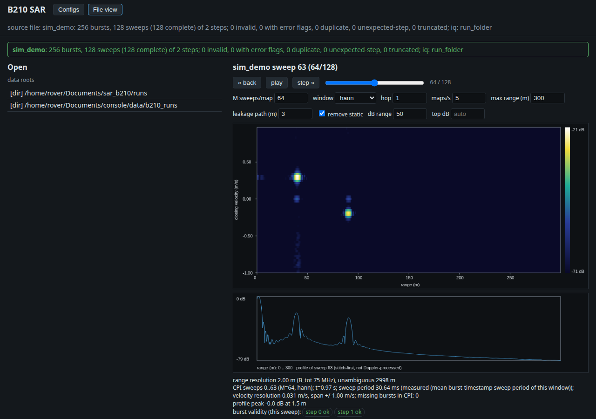

# 2 - The GUI on recorded runs and the simulator

The **File view** tab replays a run through the delay-Doppler processing and shows the map and a range profile. It reads files only: it never opens the radio and cannot transmit. Needs [tutorial 1](01_gui.md).

## What it can open

- A **run folder** written by `sar_capture` (or `sar-sim`): it has `bursts.csv` and `iq.sc16`, plus `config.yaml`, `clock_sync.csv`, `run_log.txt`.
- An **HDF5 recording** from console's recorder, holding a `SarBurst` stream (device-prefixed groups work; if the stream has no `iq` dataset, IQ is read from the run folder).

The GUI only opens files inside its **data roots**; anything else is refused (403). The default roots are `runs/` in this repo and `~/Documents/console/data` when they exist. Add or replace them with `--data-root DIR` (repeatable). Paths you give are absolute, or relative to a root.

## A simulated run, no hardware

`sar-sim` writes a synthetic run folder from a config and a scene (targets with a range, a closing velocity and an amplitude):

```bash
mkdir -p runs
cat > runs/scene.yaml <<'YAML'
num_sweeps: 128
noise_std: 20
targets:
  - {range_m: 40, velocity_mps: 0.3, amplitude: 0.1}
  - {range_m: 90, velocity_mps: -0.2, amplitude: 0.05}
YAML
env -u PYTHONPATH uv run sar-sim configs/default.yaml runs/scene.yaml runs/sim_demo
# runs/sim_demo: 256 bursts, 128 sweeps
```

`RUN_DIR` is created; `sar-sim` has no overwrite option, so pick a new name each time. Scene fields beyond these (leakage, timing jitter, DC offset, seed) are listed in `src/b210_sar/sim.py`.

## Open it

```bash
env -u PYTHONPATH uv run --extra gui python -m b210_sar.gui --port 8010 --source file --data-root runs --open sim_demo
curl http://localhost:8010/api/health      # {"ok":true}
```

`--open` opens a run folder or `.h5` at start (with `--source file`). Without it, pick a file in the list on the left, or visit `http://localhost:8010/?source=sim_demo` to open one from the URL.

The simulator includes a strong leakage path (antenna to antenna, 3 m by default), so the first map looks like horizontal stripes. In the controls, type **3** in "leakage path (m)" and tick **remove static**: the two targets appear, at 40 m / +0.3 m/s and 90 m / -0.2 m/s.



## The controls

- **back / play / step / the slider** move through the run; each position is the last sweep of a CPI.
- **M sweeps/map** sets sweeps per delay-Doppler map (more sweeps, finer velocity resolution); **window** and **hop** shape it; **maps/s** is the playback rate.
- **max range (m)**, **dB range** and **top dB** set the plot. **leakage path (m)** is the known TX-to-RX path length; empty means no leakage reference, and ranges are then relative.
- **remove static** removes the zero-Doppler (stationary) part, leaving movers.
- The strip under the map reports the run's integrity (invalid or duplicate bursts, truncated sweeps; green = clean) and per-step burst validity. Its derivation is in [delay_doppler.md](../delay_doppler.md).

## A real run, or a recording

Open one of your own runs read-only. For a run folder under console's data directory:

```bash
env -u PYTHONPATH uv run --extra gui python -m b210_sar.gui --port 8010 --data-root ~/Documents/console/data/b210_runs
```

Then pick the folder (or a `.h5` file, e.g. under `rec/`) in the list. Opening only reads the file; the GUI starts no capture. Stop it with Ctrl-C.

Next: [3, live from the radio in ROS 2](03_gui_live_ros.md).
